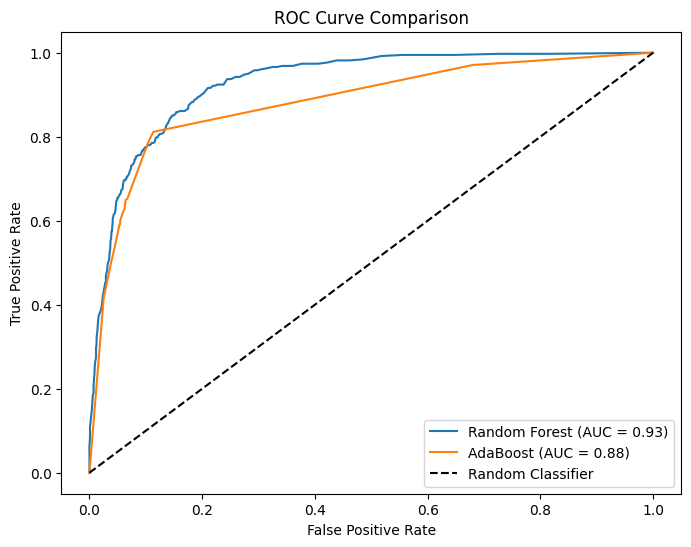

# Predicting Online Shoppers' Purchase Intention: Random Forest vs AdaBoost

> 🎓 Completed as part of the **Higher Diploma in Science in Data Analytics (QQI Level 8)** at **Dublin Business School**, 2025–2026 (graduated with First Class Honours).
*Module: Data & Network Mining (CA1). A two-person group project; I co-authored the analysis and the code.*

## Problem
Can we predict which e-commerce browsing sessions will end in a purchase (`Revenue = 1`) so the business can target promotions? Recall is the priority, because missing a buyer costs more than sending a spare promotion.

## Data
`data/online_shoppers_intention_data_set.csv`, the public UCI *Online Shoppers Purchasing Intention* dataset. About 84.4% of sessions don't generate revenue, so the classes are imbalanced.

## Tools
Python (pandas, NumPy, scikit-learn, imbalanced-learn, matplotlib, seaborn)

## Method
- Encoding and scaling, then a stratified 80/20 train/test split
- **SMOTE inside an imblearn Pipeline**, so synthetic samples are only created within training folds and nothing leaks into validation
- **GridSearchCV** (5-fold, scoring = recall) for Random Forest (`n_estimators`) and AdaBoost (`n_estimators`, `learning_rate`)
- A second tuning round using the top 8 features by importance
- Six models compared on precision, recall, F1, accuracy and AUC

## Key results
| Model | Recall (buyers) | Precision (buyers) | AUC |
|---|---|---|---|
| Random Forest, round 1 (all features) | 0.75 | 0.63 | 0.93 |
| **AdaBoost, round 2 (top 8 features)** | **0.81** | 0.58 | 0.88 |

- Feature selection lifted AdaBoost's recall from 0.77 to 0.81.
- **Recommendation:** AdaBoost (50 estimators, learning rate 0.01, top 8 features such as PageValues, Administrative and ProductRelated_Duration). It catches 81% of buyers.



## How to run
```bash
pip install -r requirements.txt
cd notebooks && jupyter notebook online_shoppers_classification.ipynb   # reads ../data/online_shoppers_intention_data_set.csv
```

## Author
Jean Ly Kon · [LinkedIn](https://www.linkedin.com/in/jeankly) · [GitHub](https://github.com/jennykonjl)
